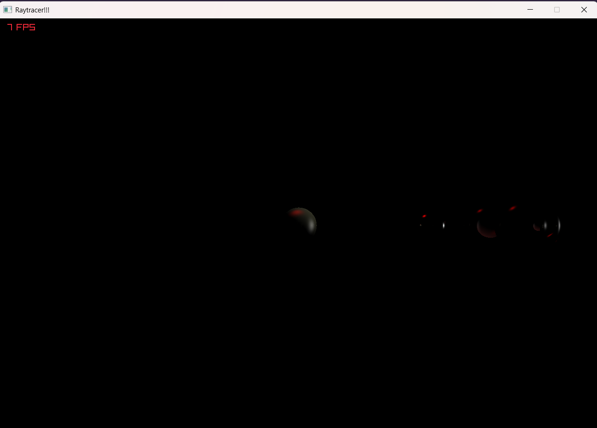

# proyecto_compu2
# proyecto_compu2 — Sistema solar con Ray Tracer en Zig

readme generado con Claude. 

## Video de demostración

[](https://youtu.be/330WOYvG3Sc)
---

Ray tracer hecho desde cero en **Zig** (con **raylib** solo para abrir la ventana y mostrar el framebuffer) que renderiza un sistema solar completo en el CPU: el Sol, los 8 planetas con su propia textura, los anillos de Saturno y un asteroide, sobre un skybox del espacio.

## Controles

| Tecla | Acción |
|---|---|
| `A` / `D` | Orbitar la cámara alrededor del sistema (horizontal) |
| `W` / `S` | Orbitar la cámara hacia arriba / abajo (limitado a ±45°) |
| Rueda del mouse | Acercar / alejar la cámara |
| `R` (mantener) | Rotación de los planetas sobre su propio eje |
| `T` (mantener) | Traslación de los planetas alrededor del Sol |

## Aspectos implementados

| Aspecto | Implementado | Cómo / dónde |
|---|:---:|---|
| Rotación en el diorama | ✅ | `R` hace girar cada planeta sobre su eje (se desplaza la coordenada `u` de la textura) y `T` los traslada alrededor del Sol. Cada planeta tiene su propia velocidad. La cámara también orbita con `A`/`D`/`W`/`S`. |
| Cámara que se acerca y se aleja | ✅ | Rueda del mouse, con un límite mínimo y máximo de distancia. |
| Materiales diferentes (textura propia y parámetros propios de albedo, especular, transparencia y reflectividad) | ✅ | El Sol y cada uno de los 8 planetas tienen su textura y sus propios valores, definidos en la tabla `cuerpos` de `main.zig`. |
| Refracción en al menos un material | ✅ | Urano: transparencia 0.25 e índice de refracción 1.31 (hielo). |
| Reflexión en al menos un material | ✅ | La Tierra (reflectividad 0.15); también Urano y Neptuno con un valor pequeño. |
| Sombras | ✅ | Cada punto prueba si algún objeto se interpone entre él y cada luz. Se ve, por ejemplo, la sombra de Saturno sobre sus anillos y viceversa. |
| Skybox | ✅ | Textura del espacio (`Skybox_space.png`) mapeada según la dirección de cada rayo que no golpea nada. |
| Concurrencia | ✅ | El render se divide en bloques de la imagen que se ejecutan en paralelo con `std.Io.Group`. |
| Material traslúcido (por ejemplo alabastro) | ⚠️ | Parcial: Urano deja ver lo que tiene detrás, pero no se simula la dispersión de la luz dentro del material. |
| Forma no vista en clase | ✅ | **Anillo** (disco con un hueco en el centro) para los anillos de Saturno, con intersección analítica rayo–plano y prueba de radios. Además se pueden cargar modelos `.obj` (el asteroide). |
| Tipo de fuente de luz no visto en clase | ✅ | Luz **direccional**, además de la luz puntual del Sol. |
| Materiales traslúcidos o reflectivos con color | ❌ | El reflejo y la refracción no se tiñen con el color del material. |
| Materiales que brillan | ✅ | El Sol emite luz propia (parámetro `brillo`) y no proyecta sombra. |
| Color bleeding | ❌ | No hay iluminación indirecta. |

## Cómo está armada la escena

- **Sistema solar:** el Sol está en el origen, con una luz puntual dentro de su esfera. Los planetas se generan en un bucle desde la tabla `cuerpos` (`src/main.zig`): nombre, textura, radio, distancia al Sol, ángulo inicial, parámetros del material y velocidades de rotación (`vel_rot`) y traslación (`vel_tr`). Los tamaños y distancias **no están a escala real**; solo conservan el orden y las proporciones aproximadas.
- **Texturas:** cada planeta busca su archivo en `src/Texturas/`. Si falta alguno no truena: avisa por consola y usa un color de respaldo.
- **Rotación y traslación:** la rotación suma un ángulo que desplaza la `u` de la textura; la traslación rota el centro de cada esfera alrededor del eje Y con una rotación 2D de (x, z), por lo que conserva la distancia al Sol.
- **Anillos de Saturno:** forma propia (`src/formas/ring.zig`) con centro, normal inclinada, radio interior y radio exterior. Se puede ver por ambas caras y acompaña a Saturno en su traslación.
- **Asteroide:** modelo `.obj` cargado por triángulos (`src/modelos/asteroide.obj`), ubicado entre Marte y Júpiter.
- **Luces:** una puntual (el Sol) y una direccional tenue de relleno para que el lado oscuro de los planetas no quede negro puro.

## Foto de sombras



## Cómo ejecutarlo

Requiere **Zig 0.16.0**. Las dependencias (raylib) se descargan solas con el sistema de paquetes de Zig.

```sh
git clone https://github.com/Emi34521/proyecto_compu2
cd proyecto_compu2
zig build run
```

Para mayor velocidad de render se recomienda compilar en modo optimizado:

```sh
zig build run -Doptimize=ReleaseFast
```

